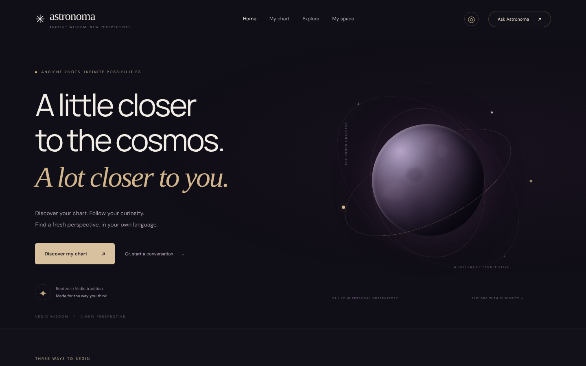
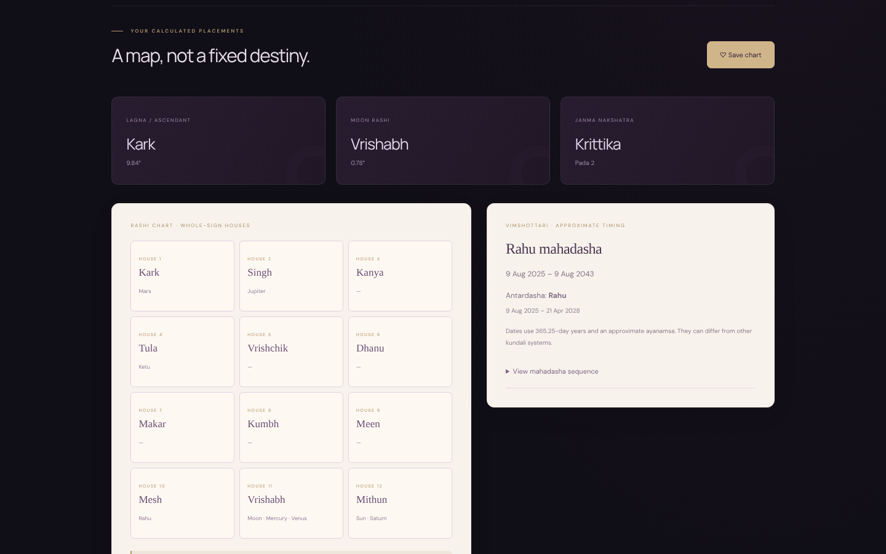
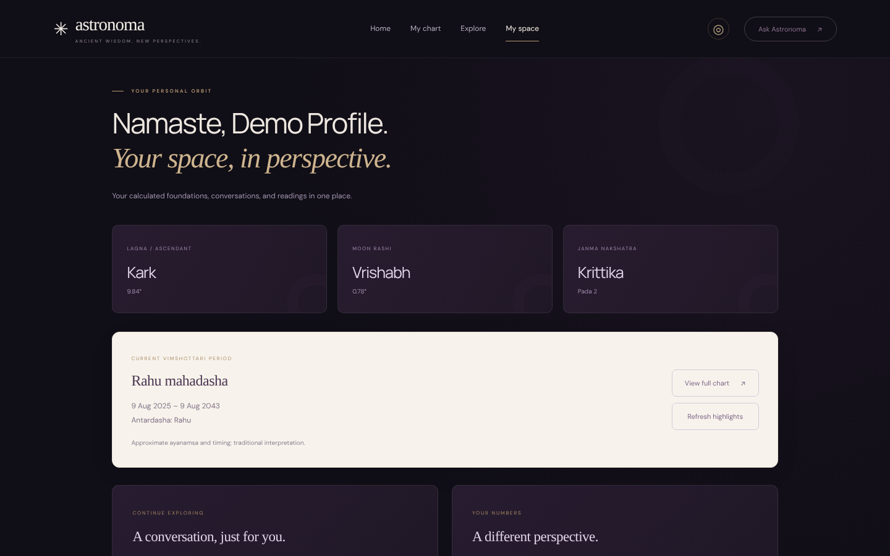
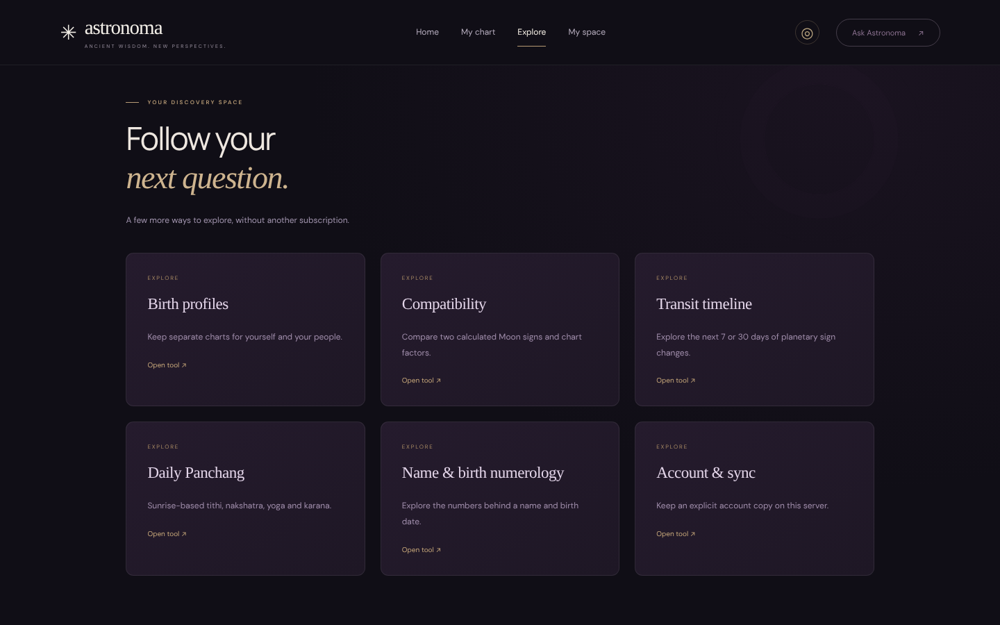
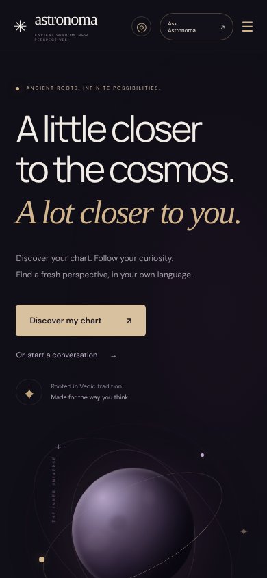
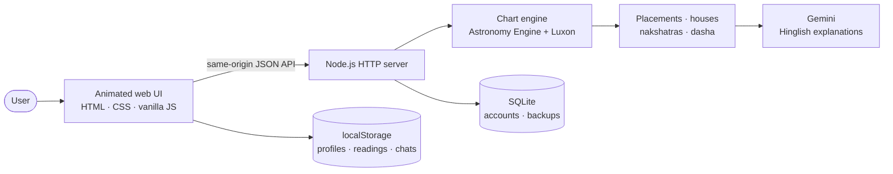

<div align="center">



# ✳ Astronoma

### Ancient wisdom. New perspectives.

**A celestial web experience for Vedic astrology, numerology and natural Hinglish AI conversations.**
Charts are calculated on the server from real astronomical positions, then explained conversationally by Gemini in the language people actually speak.

<p>
  
  
  
  
</p>
<p>
  
  
  
  
</p>

[Features](#-features) · [Screenshots](#-screenshots) · [How it works](#-how-it-works) · [Run locally](#-run-locally) · [Accuracy](#-scope--accuracy)

</div>

---

## 🌙 About

Most astrology apps either hide their maths or bolt a chatbot onto made-up text. **Astronoma does the opposite.** It computes planetary positions with an astronomy engine, shows every calculation, and only then hands the *server-calculated* placements to an AI that explains them in friendly **Hinglish**.

It began as a Streamlit experiment and grew into a standalone, responsive website with its own Node.js backend, accounts and test suite, built with **no frontend framework at all**.

## ✨ Features

<table>
<tr>
<td width="50%" valign="top">

### 🪐 Kundali & charts
- **Birth charts** with planetary placements, whole-sign houses and nakshatras (with pada)
- **Vimshottari dasha**: current mahadasha and antardasha with dates
- Birthplace lookup with coordinates and **timezone-correct** birth times (DST-aware)
- Click any planet or house to **ask about it in chat**

</td>
<td width="50%" valign="top">

### 💬 Ask Astronoma (AI)
- Natural **Hinglish conversations** powered by Gemini
- Answers grounded in **your calculated chart**, not invented placements
- Optional **voice input and spoken replies**
- Save, search, resume and export conversations

</td>
</tr>
<tr>
<td valign="top">

### 🔢 Explore
- **Numerology**: birth-date and Pythagorean name numbers, with every step of the calculation shown
- **Compatibility**: Moon-based factor comparison (no fabricated "match %")
- **Transit timeline**: planetary sign changes for the next 7 or 30 days
- **Daily Panchang**: tithi, nakshatra, yoga and karana at local sunrise

</td>
<td valign="top">

### 🔐 Your space
- **Multiple birth profiles** and a personal dashboard
- **Local accounts** with salted **scrypt** password hashing and HttpOnly sessions
- Version-checked workspace backups with conflict detection
- Fully responsive, with celestial animations and **reduced-motion support**

</td>
</tr>
</table>

## 📸 Screenshots

<table>
<tr>
<td width="50%"><p align="center"><b>Calculated kundali</b>: lagna, Moon sign, nakshatra, houses and dasha</p></td>
<td width="50%"><p align="center"><b>My space</b>: a personal dashboard for each profile</p></td>
</tr>
<tr>
<td><p align="center"><b>Explore</b>: compatibility, transits, Panchang and numerology</p></td>
<td align="center"><p align="center"><b>Mobile-first</b> responsive layout</p></td>
</tr>
</table>

## 🧭 How it works



1. **Calculate**: Astronomy Engine computes geocentric planetary positions. Luxon applies the correct historical IANA timezone. A Lahiri-style ayanamsa converts them to sidereal positions.
2. **Derive**: the server works out the ascendant, whole-sign houses, nakshatra/pada, mean lunar nodes (Rahu/Ketu) and the Vimshottari dasha sequence.
3. **Explain**: only the calculated placements and recent messages are sent to Gemini (never the raw birth details), and it answers in Hinglish.
4. **Protect**: the API key stays on the server. The backend binds to localhost, rejects cross-origin calls, limits request size and rate-limits AI use.

| Layer | Implementation |
| --- | --- |
| Interface | HTML, CSS, vanilla JavaScript, hash-based routing |
| Backend | Node.js HTTP server with same-origin JSON APIs |
| Astronomy | Astronomy Engine, Luxon |
| AI | Server-side Google Gemini integration |
| Storage | localStorage (profiles, readings, chats) · SQLite (accounts, backups) |
| Security | Salted scrypt hashes, HttpOnly sessions, CORS denial, body-size limits, rate limits |

## 🚀 Run locally

Requires **Node.js 22.13+**.

```bash
cd website
npm install
npm run dev
```

Open **http://127.0.0.1:4173**. A single server serves both the frontend and the API.

**Enable AI chat:** copy `website/.env.example` to `website/.env` and add your [Gemini API key](https://aistudio.google.com/). Charts and numerology work without a key.

## 🧪 Testing

```bash
cd website
npm run check
```

Runs syntax and frontend smoke checks plus **20 automated backend tests** covering calculation invariants, API boundaries, account isolation, workspace conflicts and AI request handling. Provider calls are mocked.

## 🔭 Scope & accuracy

Astronoma is a development project, and it says so openly:

- Sidereal conversion uses an **approximate** Lahiri-style ayanamsa, so dasha timing is approximate. Independent validation against reference kundalis is pending.
- Compatibility is a factor comparison, not full 36-Guna matching. Panchang end times and muhurta are not calculated.
- Astrology and numerology are interpretive traditions, not scientifically established predictors.

See the [detailed website guide](website/README.md) for methods, data flow and privacy notes.

## 🛣 Roadmap

- [ ] Hosted deployment with HTTPS
- [ ] Validation against reference kundalis
- [ ] Divisional charts (D9 Navamsa and more)
- [ ] Full Ashtakoota (36-Guna) compatibility

---

<div align="center">

**Designed and built by [Akshita Sharda](https://github.com/akshita-sharda)**

If you enjoyed exploring the cosmos here, consider leaving a ⭐

</div>
